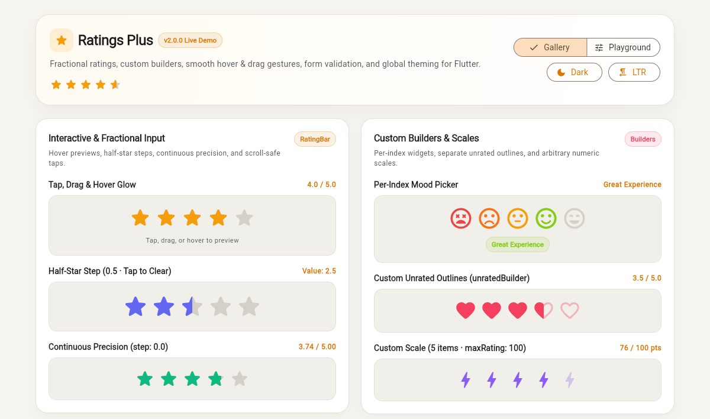
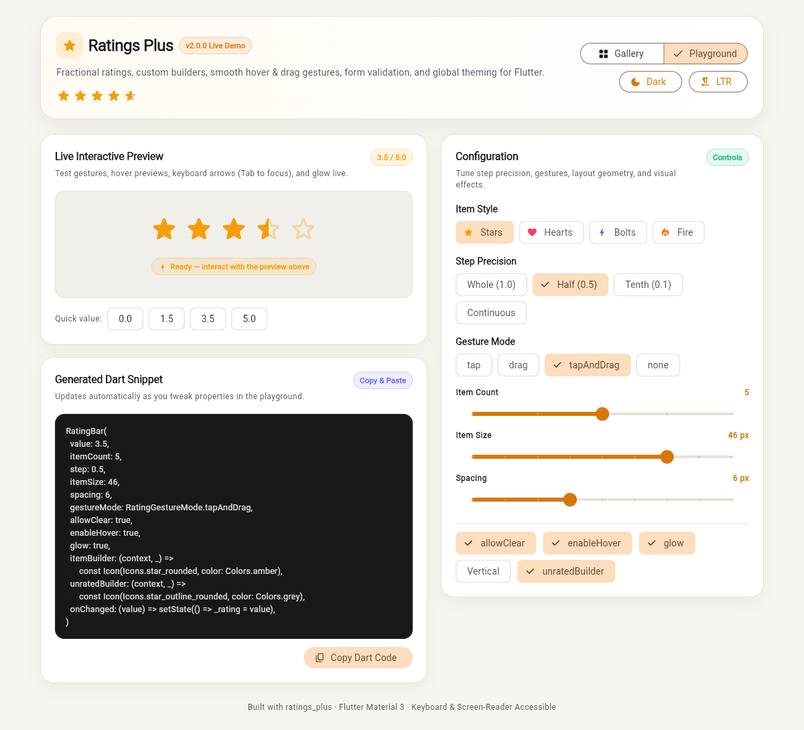
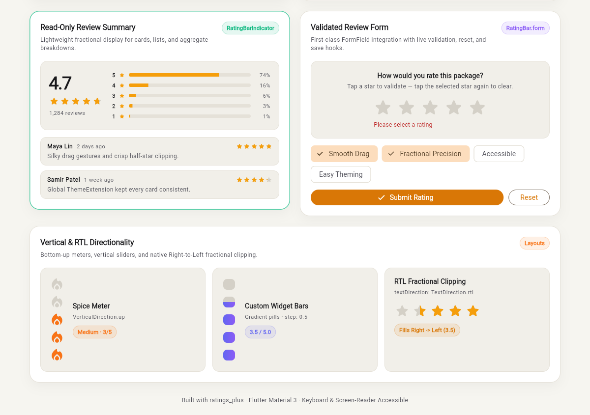
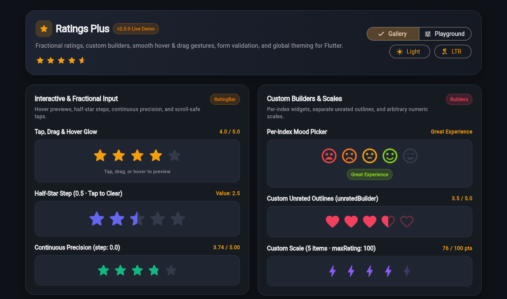
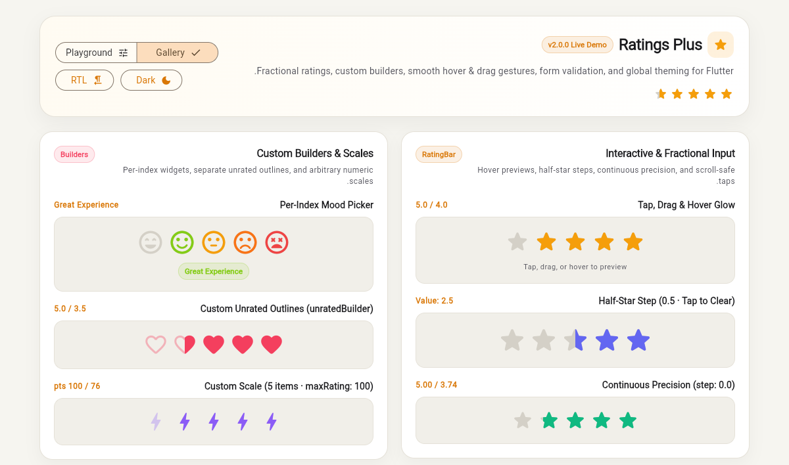

<div align="center">

# Ratings Plus

Collect and display fractional ratings in Flutter with custom item widgets, smooth touch/mouse/keyboard input, form validation, and global theming.

<p>
  <a href="https://pub.dev/packages/ratings_plus" target="_blank" rel="noopener noreferrer"></a>
  <a href="https://omar-hanafy.github.io/ratings_plus/" target="_blank" rel="noopener noreferrer"></a>
  <a href="https://github.com/omar-hanafy/ratings_plus/actions/workflows/ci.yml" target="_blank" rel="noopener noreferrer"></a>
  <a href="https://opensource.org/licenses/MIT" target="_blank" rel="noopener noreferrer"></a>
</p>

<p>
  <strong><a href="https://omar-hanafy.github.io/ratings_plus/" target="_blank" rel="noopener noreferrer">Try the Interactive Live Demo &rarr;</a></strong>
</p>

<a href="https://omar-hanafy.github.io/ratings_plus/" target="_blank" rel="noopener noreferrer">
  
</a>

<sub><em>Click any screenshot to open the live interactive Flutter Web demo.</em></sub>

</div>

## Showcase

Explore real-world patterns and customize every property live in the [GitHub Pages demo](https://omar-hanafy.github.io/ratings_plus/):

<table>
  <tr>
    <td align="center" width="50%">
      <a href="https://omar-hanafy.github.io/ratings_plus/?view=playground" target="_blank" rel="noopener noreferrer">
        
      </a>
      <br />
      <strong><a href="https://omar-hanafy.github.io/ratings_plus/?view=playground" target="_blank" rel="noopener noreferrer">Interactive Playground &amp; Live Code Generator</a></strong>
      <br />
      <sub>Tune step precision, gestures, sizing, glow, and copy ready-to-use Dart code.</sub>
    </td>
    <td align="center" width="50%">
      <a href="https://omar-hanafy.github.io/ratings_plus/?section=reviews" target="_blank" rel="noopener noreferrer">
        
      </a>
      <br />
      <strong><a href="https://omar-hanafy.github.io/ratings_plus/?section=reviews" target="_blank" rel="noopener noreferrer">Review Summaries, Validated Forms &amp; Vertical Bars</a></strong>
      <br />
      <sub><code>RatingBarIndicator</code>, <code>RatingBar.form</code>, bottom-up meters, and custom non-icon widgets.</sub>
    </td>
  </tr>
  <tr>
    <td align="center" width="50%">
      <a href="https://omar-hanafy.github.io/ratings_plus/?theme=dark" target="_blank" rel="noopener noreferrer">
        
      </a>
      <br />
      <strong><a href="https://omar-hanafy.github.io/ratings_plus/?theme=dark" target="_blank" rel="noopener noreferrer">Dark Mode &amp; Global Theming</a></strong>
      <br />
      <sub>Define consistent defaults across light and dark themes with <code>RatingBarThemeData</code>.</sub>
    </td>
    <td align="center" width="50%">
      <a href="https://omar-hanafy.github.io/ratings_plus/?rtl=true" target="_blank" rel="noopener noreferrer">
        
      </a>
      <br />
      <strong><a href="https://omar-hanafy.github.io/ratings_plus/?rtl=true" target="_blank" rel="noopener noreferrer">Native RTL Directionality</a></strong>
      <br />
      <sub>Automatic right-to-left fractional clipping, gestures, and keyboard arrows.</sub>
    </td>
  </tr>
</table>

## Features

*   **Versatile Modes**:
    *   **Interactive**: `RatingBar` for user input.
    *   **Read-only**: `RatingBarIndicator` for displaying static values.
    *   **Form Integration**: `RatingBar.form` for validation and easy form submission.
*   **Interaction Models**:
    *   **Controlled**: Parent manages state (like a standard `Checkbox` or `Slider`).
    *   **Uncontrolled**: Widget manages its own state, ideal for simple use cases.
*   **Precision Control**: Support for any fractional step (e.g., `0.5` for half-stars, `0.1` for tenths, or `0.0` for continuous floating-point selection) and arbitrary scales via `maxRating`.
*   **Scroll-Safe Gestures**:
    *   **Tap**: Commits on release so vertical scrolling from the bar keeps the selection intact.
    *   **Drag**: Smooth sliding selection across items.
    *   **Tap & Drag**: Combines both interactions, with optional tap-to-clear (`allowClear`).
*   **Input & Accessibility**:
    *   **Mouse Support**: Live hover previews (`enableHover`) and custom `WidgetStateProperty<MouseCursor?>` cursors.
    *   **Keyboard Support**: Arrow keys, Home, End, and Page Up/Down navigation.
    *   **Semantics**: Interactive bars expose one labeled slider with value and adjustment actions; indicators expose a read-only value.
*   **Customization**:
    *   **Builders**: Use any widget (Icons, Images, SVGs, custom containers) for both rated (`itemBuilder`) and unrated (`unratedBuilder`) states.
    *   **Styling**: Custom colors, spacing, sizing, glow effects, and animation curves.
    *   **Layout**: Horizontal or vertical (`VerticalDirection.up` / `down`), with native LTR/RTL support.
    *   **Theming**: Define global defaults via `RatingBarThemeData` in `ThemeData.extensions`.

## Installation

The examples use `material_ui` for Material widgets and `ratings_plus` for the rating controls. Add both dependencies to your app:

```yaml
dependencies:
  material_ui: '>=0.0.1 <2.0.0'
  ratings_plus: ^2.0.0
```

The package supports Flutter 3.38.5 and later. Apps upgrading from 1.x should match their Material imports to the resolved `material_ui` version. See the [Migration guide](https://github.com/omar-hanafy/ratings_plus/blob/main/MIGRATION.md).

## Usage

```dart
import 'package:material_ui/material_ui.dart';
import 'package:ratings_plus/ratings_plus.dart';
```

### 1. Interactive Rating Bar

#### Uncontrolled (Stateful)

The simplest way to get started. The widget manages its own internal state.

```dart
RatingBar(
  initialValue: 3.5,
  enableHover: true,
  onChanged: (value) {
    print('Rating updated: $value');
  },
  itemBuilder: (context, index) => const Icon(
    Icons.star_rounded,
    color: Colors.amber,
  ),
)
```

#### Controlled (Stateless)

Use controlled mode when parent state, BLoC, Riverpod, or another state manager owns the value.

```dart
RatingBar(
  value: _myRating, // Sourced from parent state
  onChanged: (value) {
    setState(() => _myRating = value);
  },
  itemBuilder: (context, index) => const Icon(
    Icons.star_rounded,
    color: Colors.amber,
  ),
)
```

### 2. Fractional & Continuous Precision

Set `step: 0.5` for half-stars, `step: 0.1` for tenths, or `step: 0.0` for continuous selection. Use `RatingGestureMode.tap` inside scrollable lists when you want taps only.

```dart
RatingBar(
  value: _fractionalRating,
  step: 0.5,
  allowClear: true,
  gestureMode: RatingGestureMode.tap,
  itemSize: 40,
  spacing: 4,
  itemBuilder: (context, _) => const Icon(
    Icons.star_rounded,
    color: Colors.indigo,
  ),
  onChanged: (value) => setState(() => _fractionalRating = value),
)
```

### 3. Custom Shapes, Moods & Unrated Outlines

Supply per-index widgets in `itemBuilder`, or provide a separate `unratedBuilder` for distinct empty shapes (such as outlined hearts).

```dart
// Outlined hearts with fractional fill
RatingBar(
  value: _heartRating,
  step: 0.5,
  spacing: 6,
  enableHover: true,
  glowColor: Colors.pinkAccent,
  itemBuilder: (context, _) => const Icon(
    Icons.favorite_rounded,
    color: Colors.pinkAccent,
  ),
  unratedBuilder: (context, _) => Icon(
    Icons.favorite_border_rounded,
    color: Colors.pinkAccent.withValues(alpha: 0.35),
  ),
  onChanged: (value) => setState(() => _heartRating = value),
)
```

```dart
// Per-index sentiment / mood selector
RatingBar(
  initialValue: 4,
  itemCount: 5,
  spacing: 6,
  semanticLabel: 'Mood rating',
  itemBuilder: (context, index) {
    const icons = [
      (Icons.sentiment_very_dissatisfied_rounded, Colors.red),
      (Icons.sentiment_dissatisfied_rounded, Colors.deepOrange),
      (Icons.sentiment_neutral_rounded, Colors.amber),
      (Icons.sentiment_satisfied_rounded, Colors.lightGreen),
      (Icons.sentiment_very_satisfied_rounded, Colors.green),
    ];
    final (icon, color) = icons[index];
    return Icon(icon, color: color);
  },
  onChanged: (value) {},
)
```

### 4. Vertical Meters & Custom Scales

Combine `Axis.vertical` with `VerticalDirection.up` for bottom-up meters, or use `maxRating` to decouple the visual item count from the numeric scale.

```dart
// Bottom-up vertical meter using custom gradient widgets
RatingBar(
  value: _intensity,
  direction: Axis.vertical,
  verticalDirection: VerticalDirection.up,
  step: 0.5,
  itemCount: 5,
  itemSize: 32,
  spacing: 4,
  itemBuilder: (context, _) => Padding(
    padding: const EdgeInsets.symmetric(horizontal: 4, vertical: 5),
    child: SizedBox(
      width: 24,
      height: 22,
      child: DecoratedBox(
        decoration: BoxDecoration(
          gradient: const LinearGradient(
            colors: [Colors.indigo, Colors.deepPurpleAccent],
          ),
          borderRadius: BorderRadius.circular(8),
        ),
      ),
    ),
  ),
  onChanged: (value) => setState(() => _intensity = value),
)
```

```dart
// 5 visual items representing a 0–100 score in steps of 5
RatingBar(
  value: _score, // e.g., 75.0
  itemCount: 5,
  maxRating: 100,
  step: 5,
  itemBuilder: (context, _) => const Icon(Icons.bolt_rounded, color: Colors.deepPurple),
  onChanged: (value) => setState(() => _score = value),
)
```

### 5. Read-Only Indicator

Optimized for displaying averages, product cards, or static reviews. It ignores input and announces a read-only semantic value.

```dart
RatingBarIndicator(
  value: 4.7,
  itemCount: 5,
  itemSize: 20.0,
  spacing: 2.0,
  semanticLabel: 'Average rating',
  itemBuilder: (context, _) => const Icon(
    Icons.star_rounded,
    color: Colors.amber,
  ),
)
```

### 6. Form Integration

Keep a `GlobalKey<FormState>` named `formKey` in the parent state. This form accepts ratings of one star or more, and clearing the selection returns it to zero.

```dart
Form(
  key: formKey,
  child: Column(
    children: [
      RatingBar.form(
        initialValue: 0.0,
        semanticLabel: 'Form rating',
        validator: (value) {
          if (value == null || value < 1.0) {
            return 'Please select a rating';
          }
          return null;
        },
        onSaved: (value) {
          // Save valid value
        },
        itemBuilder: (context, _) => const Icon(
          Icons.star_rounded,
          color: Colors.deepPurple,
        ),
      ),
      ElevatedButton(
        onPressed: () {
          final form = formKey.currentState!;
          if (form.validate()) form.save();
        },
        child: const Text('Submit'),
      ),
    ],
  ),
)
```

## Interaction Lifecycle

Use the pointer callbacks to track a tap or drag from selection to completion.

*   `onChangeStart` reports the rating under the pointer when a tap or drag starts. Use it for a temporary preview.
*   `onChanged` reports the selected value after a tap or as a drag crosses rating steps. Keyboard and accessibility adjustments also use this callback.
*   `onChangeEnd` receives the final gesture value. If a parent scrollable cancels a pending tap, it receives the current rating.

```dart
RatingBar(
  onChanged: (val) => setState(() => _current = val),
  onChangeStart: (val) => _showPreview(val),
  onChangeEnd: (val) => _saveToDatabase(val),
  itemBuilder: (context, _) => const Icon(Icons.star_rounded, color: Colors.amber),
)
```

## Configuration

### Layout & Behavior

| Property | Default | Description |
|---|---|---|
| `direction` | `Axis.horizontal` | Layout direction (`Axis.horizontal` or `Axis.vertical`). |
| `verticalDirection` | `VerticalDirection.down` | Flow direction for vertical layouts (`down` or `up`). |
| `textDirection` | `Directionality` | LTR or RTL layout and fill direction. |
| `gestureMode` | `RatingGestureMode.tapAndDrag` | Interaction model: `tap`, `drag`, `tapAndDrag`, or `none`. |
| `step` | `1.0` | Value snap interval (set to `0.0` for continuous). |
| `minRating` | `0.0` | Minimum selectable value. |
| `maxRating` | `itemCount` | Maximum value (allows scaling, e.g., 5 items = 100 points). |
| `allowClear` | `true` | Whether tapping the current value resets it to `minRating`. |
| `enableKeyboard` | `true` | Enables arrow keys, Home/End, and Page Up/Down navigation. |
| `autofocus` | `false` | Whether to request focus on mount. |

### Visuals & Animations

| Property | Default | Description |
|---|---|---|
| `itemSize` | `40.0` | Size of each rating item (width and height). |
| `spacing` | `0.0` | Logical pixel spacing between items. |
| `unratedColor` | `ThemeData.disabledColor` | Color filter for unrated items (when `unratedBuilder` is null). |
| `glow` | `true` | Show glow effect during interaction. |
| `glowColor` | `ColorScheme.primary` | Color of the touch glow. |
| `glowRadius` | `2.0` | Spread radius of the glow. |
| `glowBlurRadius` | `10.0` | Blur radius of the glow. |
| `animationDuration` | `150ms` | Duration for value change animations. |
| `animationCurve` | `Curves.easeOutCubic` | Curve for value change animations. |
| `mouseCursor` | `click` / `basic` | Custom `WidgetStateProperty<MouseCursor?>` cursor for pointer hover. |
| `enableHover` | `false` | Show rating preview on mouse hover (desktop/web). |
| `enableFeedback` | `true` | Request haptic feedback on discrete rating changes. |

## Global Theming

Add `RatingBarThemeData` to `ThemeData.extensions` in your `material_ui` app. Individual widget properties take precedence.

```dart
MaterialApp(
  theme: ThemeData(
    extensions: const [
      RatingBarThemeData(
        itemSize: 32.0,
        spacing: 4.0,
        glowColor: Colors.amberAccent,
        unratedColor: Colors.grey,
        animationCurve: Curves.easeInOut,
      ),
    ],
  ),
  // ...
)
```

## Accessibility

Tab focuses an interactive rating bar when `enableKeyboard` is enabled. Arrow keys along the bar's axis adjust by one step, respecting RTL and vertical direction. Page Up and Page Down increase and decrease by one step. Home selects the minimum and End selects the maximum. Continuous ratings use one rating unit for keyboard and accessibility adjustments.

The control exposes its label, current value, and adjustment actions to assistive technology. The default value text uses one decimal place, such as `3.5 / 5.0`. Set `semanticLabel` to identify the item being rated and `semanticValueFormatter` for localized wording or finer precision.

## Example App

*   **Live Web Demo:** <a href="https://omar-hanafy.github.io/ratings_plus/" target="_blank" rel="noopener noreferrer">https://omar-hanafy.github.io/ratings_plus/</a>
*   **Run locally:**
    ```sh
    cd example
    flutter run
    ```

## License

MIT
